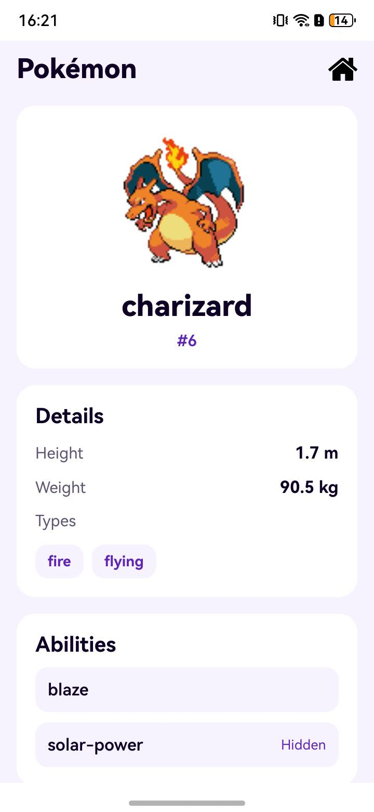

# PokemonList

PokemonList is an OpenHarmony example for browsing Pokémon, their types, abilities, and evolution data on default and tablet devices.

## What this example demonstrates

| Capability | API or platform service | Where to look |
| --- | --- | --- |
| Load and search a Pokémon list, then fetch types for visible rows | ArkUI `Search` and `LazyForEach` with `IDataSource` | [Index.ets](entry/src/main/ets/pages/Index.ets), [DataSource.ets](entry/src/main/ets/data/DataSource.ets) |
| Request and parse Pokémon data | `@kit.NetworkKit` HTTP client and PokéAPI | [DataSource.ets](entry/src/main/ets/data/DataSource.ets) |
| Open Pokémon, type, and ability details | ArkUI router and detail pages | [PokeDetail.ets](entry/src/main/ets/pages/PokeDetail.ets), [TypeDetail.ets](entry/src/main/ets/pages/TypeDetail.ets), [AbilityDetail.ets](entry/src/main/ets/pages/AbilityDetail.ets) |

## Preview



## Requirements

- Node.js 20 or later, a JDK (the [CI build](.github/workflows/build.yml) uses JDK 17), and Oniro App Builder 0.10.0.
- The OpenHarmony 6.1 (API 23) SDK and command-line tools. The [build profile](build-profile.example.json5) compiles and targets API 23 and declares compatibility with API 20.
- An OpenHarmony device supported by the module's `default` or `tablet` [device types](entry/src/main/module.json5) for running the app.
- Internet access to `pokeapi.co` for data and `raw.githubusercontent.com` for sprites. The module requests `ohos.permission.INTERNET`.

## Build and run

Run these commands from the repository root:

```sh
npm install -g @oniroproject/oniro-app@0.10.0
oniro-app sdk install 6.1
oniro-app cmdtools install
cp build-profile.example.json5 build-profile.json5
oniro-app sign
oniro-app build --json
```

In Windows PowerShell, use `Copy-Item build-profile.example.json5 build-profile.json5` in place of `cp`. The generated profile and `signatures/` hold local development signing material. `oniro-app sign` uses development credentials; release distribution requires separate signing credentials and provisioning.

With a connected device, install and launch the signed build from the repository root:

```sh
oniro-app app install
oniro-app app launch
```

The build produces `entry/build/default/outputs/default/entry-default-signed.hap`. Device installation and launch are manual steps.

## Use

Open the list and search by Pokémon name. Select a Pokémon to see its height, weight, types, abilities, and evolution chain. Select a type for attack and defense relationships, or an ability for its English effect and related Pokémon.

## Explore the implementation

[EntryAbility.ets](entry/src/main/ets/entryability/EntryAbility.ets) loads the list page. [Index.ets](entry/src/main/ets/pages/Index.ets) manages search, navigation, and visible-row type requests; [DataSource.ets](entry/src/main/ets/data/DataSource.ets) handles network requests. The three detail pages render Pokémon, type, and ability data. See [Implementation](docs/implementation.md) for the current data flow and error handling.

## Verify

The repository build can be checked with `oniro-app build --json`. On a device, load the list, search, scroll quickly and stop, open a Pokémon, then open a type, ability, and evolution entry. Disconnect and reconnect the network to check the error and retry paths.

## Limitations

The app depends on live PokéAPI responses and remote sprite images; it has no offline data cache. Type labels load after list rows appear. API 20 compatibility is declared in the build profile; behavior on each device and OS version still needs device verification.

## Contributing

These apps are focused examples of specific platform capabilities. Contributions that keep an example correct, buildable, and clear are welcome, including bug fixes, documentation and setup corrections, and improvements to its existing behavior. Please keep pull requests within the app's stated purpose and describe how you verified the change.

**Found a problem but can't fix it?** Open an issue in this repository; a pull request is not required. For a bug or broken build, include the steps to reproduce it, what you expected, what happened, and your device, OS, and SDK/API version. Logs or screenshots are helpful when available. You can also open an issue for inaccurate or unclear documentation.

## License

The repository includes the Apache License, Version 2.0 text in [LICENSE](LICENSE). This statement does not establish rights to Pokémon names, artwork, or remotely loaded sprites.
